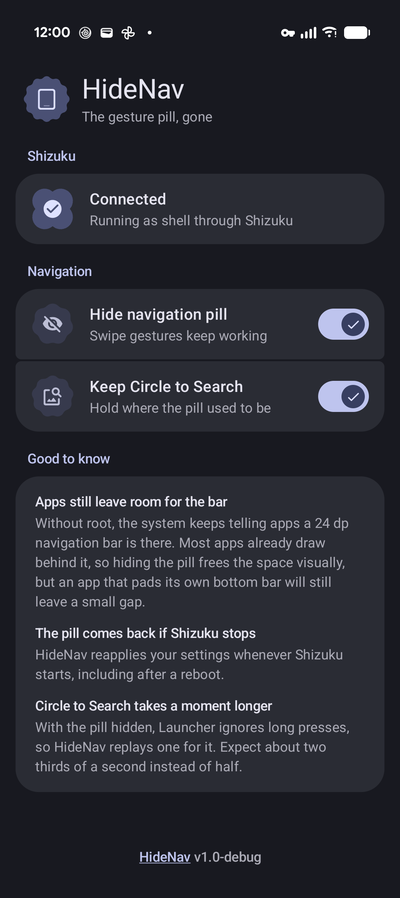
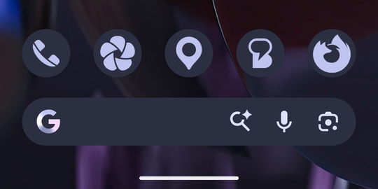
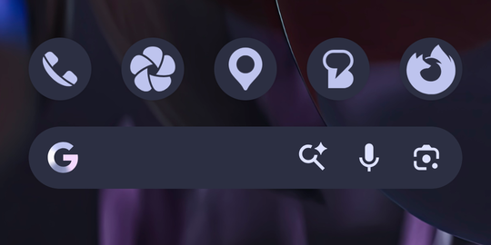

# HideNav

HideNav hides the gesture navigation pill on Pixel phones without root. It uses
[Shizuku](https://github.com/RikkaApps/Shizuku) (or a fork such as Nightzuku) to run a
small service with shell permissions. You can optionally keep Circle to Search working by
holding the spot where the pill used to be.

Tested on a Pixel 9 running Android 17 (build CP3A.261005.005) with Pixel Launcher.

<p align="center">
  
</p>

## Requirements

- A Pixel with gesture navigation
- Shizuku or a compatible fork, started and running
- Android 12 or newer

## How it works

### Hiding the pill

On recent Pixels the pill isn't drawn by SystemUI. Pixel Launcher draws it as part of its
taskbar, which phones use in place of the old navigation bar. Launcher fades the pill out
whenever SystemUI reports that the Home button is disabled. That is the
`StatusBarManager.DISABLE_HOME` flag, which kiosk and setup-wizard modes normally use.

The shell user holds the `STATUS_BAR` permission, so through Shizuku HideNav can set that
flag itself (`IStatusBarService.disable`). With it set:

- the pill is gone
- swiping up to go home still works, as do swipe-and-hold for Recents and the back gesture
- Launcher stops accepting long presses on the handle, so Circle to Search no longer opens
  from there

| Pill shown | Pill hidden |
| :---: | :---: |
|  |  |

The equivalent from a computer is `adb shell cmd statusbar send-disable-flag home`.

The flag is tied to a binder token owned by HideNav's Shizuku service. If that service
stops, including when Shizuku itself stops, system_server clears the flag and the pill
comes back, so a crash can't leave you stuck without one. HideNav reapplies your settings
whenever Shizuku hands it a binder again, which includes after a reboot once Shizuku is
running.

### Keeping Circle to Search

The shell user can't start Circle to Search directly:
`IContextualSearchManager.startContextualSearch` needs a permission only system apps get.
Launcher's own long-press detector does accept injected touches, though, and the shell
user can inject them.

With "Keep Circle to Search" on, HideNav puts an invisible 180 dp wide touch zone over the
pill's old spot:

1. Launcher watches the bottom edge through an input monitor. That runs in parallel with
   normal touch delivery, so a swipe that starts in the zone still works: Launcher claims
   the pointer and the zone gets a cancel.
2. If a touch stays still for 150 ms, HideNav's service lifts the flag, waits 25 ms for
   Launcher to see the change, and replays a long press at the same spot. Launcher picks
   how to handle a touch when it starts, so the flag goes straight back on and the pill
   only flashes for a frame or two. Launcher's own long-press timeout (450 ms) then runs
   from the replayed press, and it opens Circle to Search the normal way.
3. A quick tap in the zone is forwarded to whatever is underneath. The zone becomes
   untouchable for a moment and the tap is re-injected.

The zone needs "display over other apps", which HideNav grants itself through Shizuku
(`appops set … SYSTEM_ALERT_WINDOW allow`). While the zone is showing, Android keeps the
app's process at perceptible priority, so no foreground notification is needed.

## Limitations

- **Apps still leave room for the bar.** Launcher's taskbar window still reports a 24 dp
  navigation bar inset, and without root nothing can change that. Apps that draw
  edge-to-edge (most of them, since Android 15 enforces it for apps targeting SDK 35 and
  later) already draw behind the pill, so the space is freed visually. An app that pads its
  own bottom bar for the inset will still leave a gap.
- **Circle to Search takes slightly longer.** It opens after about 640 ms of holding
  instead of about 450 ms, because HideNav's hold detection runs before Launcher's own
  timer starts. The pill shows for about 30 ms while the press is replayed.
  Launcher's timer is a DeviceConfig flag (`launcher/LPNH_TIMEOUT_MS`) that the shell user
  isn't allowed to change on Android 17.
- **The touch zone is always there** while the feature is on, including in fullscreen
  games and video. Taps get forwarded underneath, but a game that reads holds or drags at
  the very bottom centre of the screen won't see them.
- **It depends on Pixel Launcher's behaviour.** The pill-hiding relies on how Launcher
  handles the Home-disabled state, and Circle to Search relies on Launcher's long-press
  handling. A Launcher update could change either.

## Things that don't work without root

These were tried on the device above and ruled out:

- **Resource overlays.** Shrinking `navigation_bar_height` to 0 is the usual root approach.
  `cmd overlay fabricate` refuses non-root callers, and since the restriction was moved
  into `OverlayManagerService` itself, calling `IOverlayManager.commit` directly from the
  shell (the route ColorBlendr-style apps used) fails too ("Non-root shell cannot fabricate
  overlays"). An installed overlay APK has to be signed with the platform key, or target a
  resource the target app declares overlayable. framework-res, SystemUI and Pixel Launcher
  declare none.
- **Global immersive mode.** `settings put global policy_control immersive.navigation=*`
  was removed in Android 11.
- **Overscan.** `wm overscan` was removed in Android 11. `wm size` only rescales the
  display.
- **Forcing apps edge-to-edge.** Android 15 added a compat change, `ENFORCE_EDGE_TO_EDGE`,
  that apps targeting older SDKs could in principle be switched onto. It isn't marked
  overridable, and `am compat enable ENFORCE_EDGE_TO_EDGE <package>` refuses with "Cannot
  override a change on a non-debuggable app and user build." It wouldn't remove the gap
  anyway: edge-to-edge apps still receive the 24 dp inset and usually pad for it.
- **Feature flags.** Launcher has DeviceConfig flags for tuning the long press, but none
  for hiding the pill or its inset. `aflags` requires root.

## Building

```sh
./gradlew :app:assembleDebug
adb install -r app/build/outputs/apk/debug/app-debug.apk
```

The debug build installs as `xyz.draumaz.hidenav.debug` alongside a release build.
Release builds are signed with the local debug key until a release keystore is set up.

## License

GPL-3.0-or-later.
